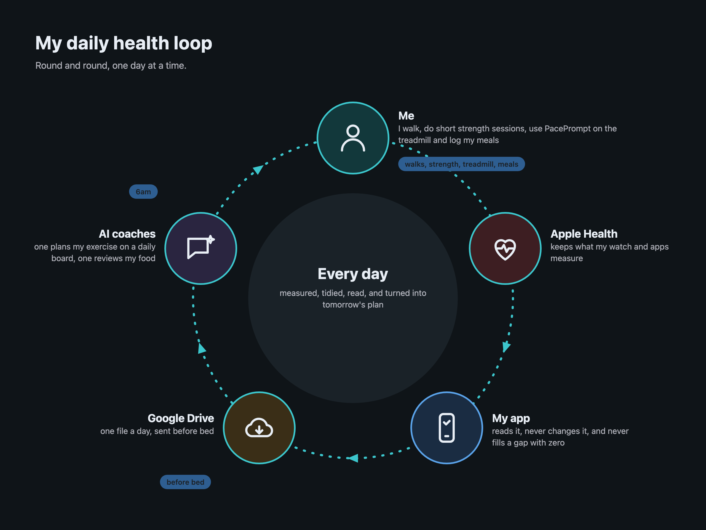
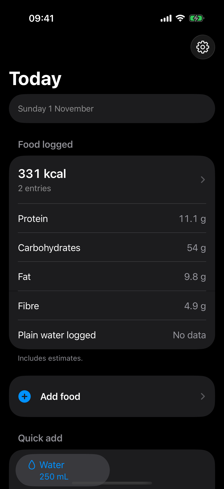
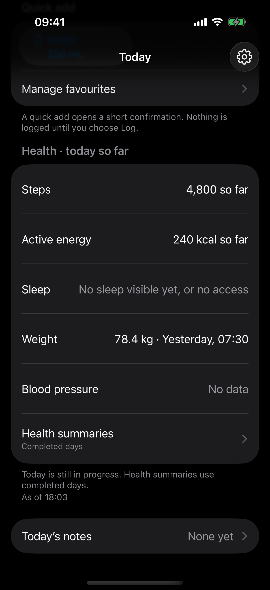
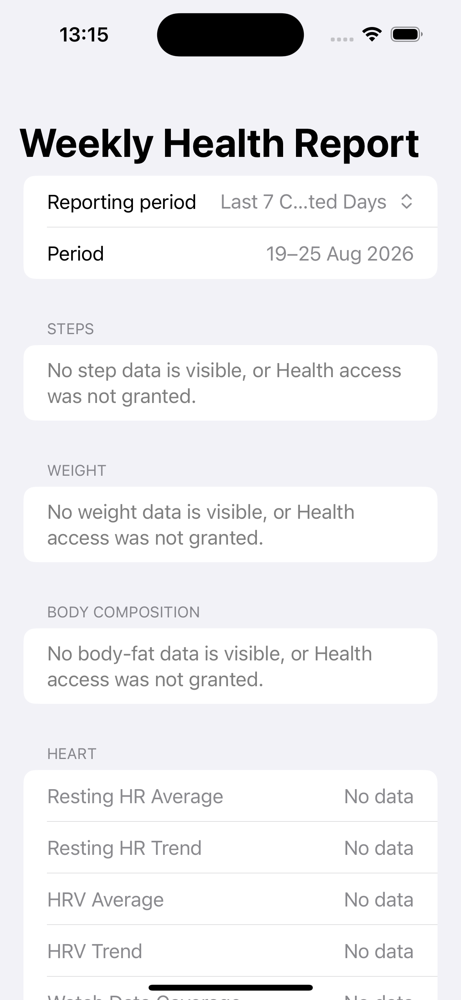
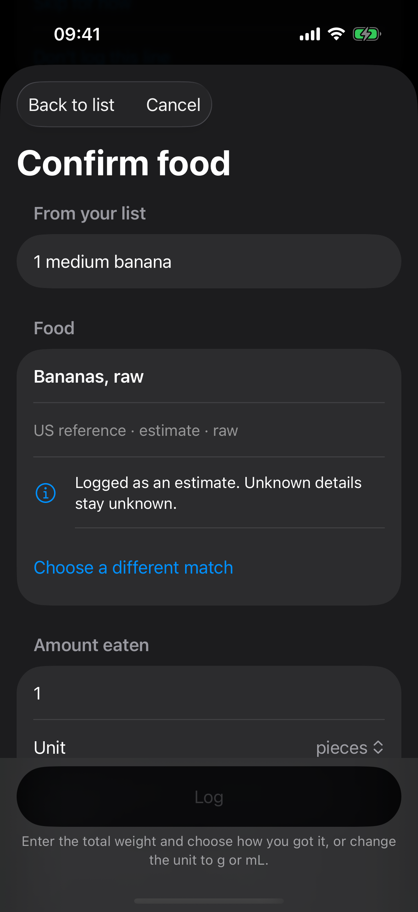
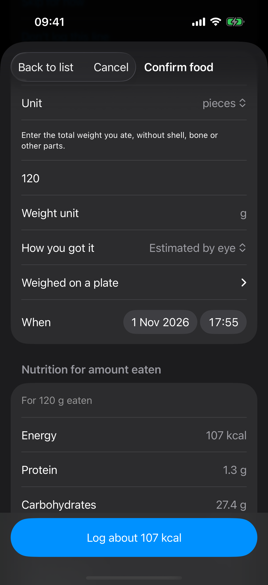
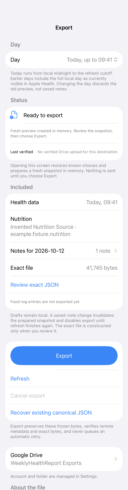

# Weekly Health Report

A personal iPhone app that reads Apple Health, logs what I eat and sends a reviewed daily export to Google Drive, where two scheduled AI coaches pick it up. It started as a weekly summary I could trust, because an Apple Shortcut gave numbers that did not match the Health app, and it has grown into a food log built around one person's needs.

It is an informational utility, not medical software.

The app sits in the middle of the loop. Apple Health keeps what is measured, the app reads it without changing it, and the daily export is the only thing the coaches see. Its companion treadmill app is described in [Driving a Treadmill From a PDF Specification](https://sertan.com/driving-a-treadmill-from-a-pdf-specification/) ([PacePrompt](https://github.com/syamaner/paceprompt-ios)).

## Principles

These rules are closed: they change only through a versioned contract, and tests and boundary checks cover them.

1. **Apple Health is read-only.** The app never writes to HealthKit. HealthKit does not reveal a denied read, so the app says "no visible data or no access", never zero.
2. **Unknown is never zero.** Missing data stays missing, estimates are labelled as estimates, and a partial total is shown as a known minimum.
3. **Report averages use completed days.** Averages use whole local-calendar days, aggregated within each day first so a busy day does not dominate. Today's partial values are a separate, labelled "today so far", latest readings use their own lookback, and the Daily JSON covers one selected day.
4. **HealthKit does the arithmetic.** Cumulative values use HealthKit statistics, so iPhone and Apple Watch samples are never added up by hand, and blood-pressure readings stay as intact pairs.
5. **Every food entry is your decision.** Search results and label readings only pre-fill the shared Confirm screen. No entry is logged without an explicit Log, and saved records are versioned and append-only.
6. **Nothing leaves without a choice.** There is no backend, analytics or background sync. The daily export (the health Daily JSON and, with Food log on, the food daily file) goes to Drive only after you review it and tap Export. Online food lookups, such as Open Food Facts or OpenRouter with your own key, run only when you enable or start them. Every outbound destination is listed in the [egress policy](docs/privacy-and-egress.md).

## How it works

<table>
  <tr>
    <td></td>
    <td></td>
    <td></td>
  </tr>
  <tr>
    <td align="center">Today: food logged so far</td>
    <td align="center">No data is not zero</td>
    <td align="center">The completed-day report</td>
  </tr>
  <tr>
    <td></td>
    <td></td>
    <td></td>
  </tr>
  <tr>
    <td align="center">A match is a suggestion; Log waits for the amount</td>
    <td align="center">One Log action, for the amount eaten</td>
    <td align="center">Review the day, then Export</td>
  </tr>
</table>

All screenshots are taken in the iOS Simulator with invented values. The repository holds no personal health data.

- **Today** shows what you have logged so far and opens **Add food**. Every route (search, barcode, a pasted list, a nutrition label or a favourite) ends on the same Confirm screen.
- **Health** is the completed-day report: pick a period, read the summary tiles and sections, and use **Copy all** or the screenshot editor's Full Page for a plain-text or PDF version.
- **Export** prepares one day's files, shows exactly what is included and sends it to a Drive folder you chose, only when you tap Export.
- **Developer Diagnostics** shows the per-day values behind every figure, so each one can be checked against Apple Health.

## What it covers

| Area | Measurements |
| --- | --- |
| Body | Weight, body fat and waist, with trends |
| Activity | Steps, active energy, exercise time and workouts |
| Heart and sleep | Blood pressure, resting heart rate, HRV, sleep and Apple Watch coverage |
| Fitness | VO₂ max over four weeks, three months and six months, and blood oxygen |
| Glucose and medications | Daily-first glucose averages, and taken medication events on iOS 26 or later |
| Food and water | The app's own food log: energy, macronutrients, fibre and plain water |
| Daily JSON only | All 39 HealthKit dietary types, workout detail and private notes you choose to export |

## Method

The first brief was mostly about what correct means, metric by metric, and that is still how the app is built:

- **Semantics before code.** Each metric and contract is written down first, edge cases included, in the [app reference](docs/app-reference.md) and the [contracts in `docs/`](docs/README.md).
- **Checked against Apple Health.** Developer Diagnostics exposes the daily inputs, and the [validation checklist](docs/app-reference.md#check-the-results-against-apple-health) compares each metric with the Health app on a real iPhone.
- **Tested in layers.** Pure rule tests with synthetic fixtures, view-model tests for orchestration, simulator UI tests for the routes, and boundary checks that keep the food domain free of HealthKit, storage and networking.
- **Built with coding agents.** Codex and Claude Code did most of the implementation under the rules in [AGENTS.md](AGENTS.md), with read-only reviewers checking changes against the principles above. [DEVELOPMENT_NOTES.md](DEVELOPMENT_NOTES.md) records each phase with bounded token and API-equivalent cost estimates, or marks it Unmeasured.

## Run it

You need a Mac with the current stable Xcode, an iPhone and an Apple development team. The deployment target is iOS 17.

1. Open `WeeklyHealthReport.xcodeproj`.
2. Copy `Config/Signing.local.xcconfig.example` to `Config/Signing.local.xcconfig`, then set your team ID and a bundle identifier of your own.
3. Run on your iPhone and approve the Health read permissions you want to use.

Google Drive export stays disabled until you add your own OAuth client; see [Run it on your iPhone](docs/app-reference.md#run-it-on-your-iphone).

## More detail

- [App reference](docs/app-reference.md): screens, export, privacy, reporting periods, Copy all and every calculation rule
- [Privacy policy](docs/privacy-policy.txt) and [egress policy](docs/privacy-and-egress.md)
- [Contracts and plans](docs/README.md)

## Licence

Licensed under the [MIT License](LICENSE).
